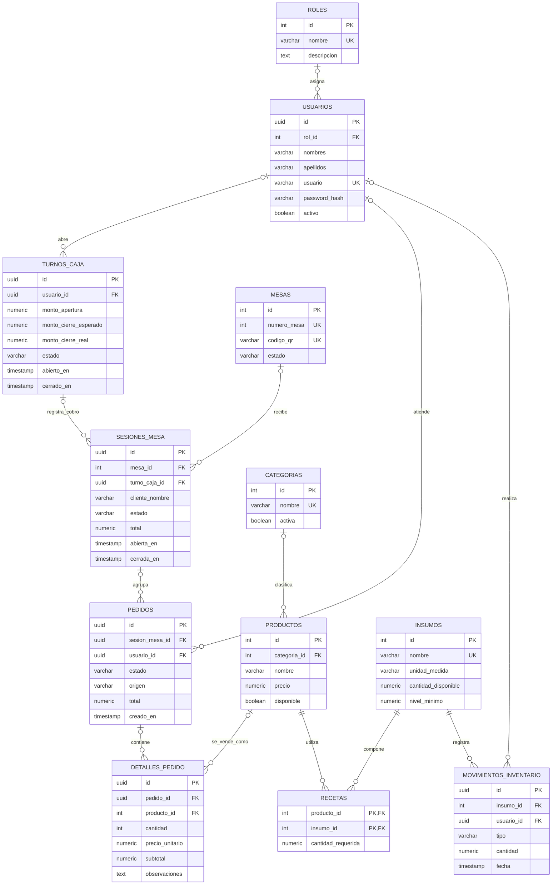

# Esquema de la base de datos

Base PostgreSQL de Pupusería Albi. La relación de una mesa con sus sesiones se guarda únicamente en `sesiones_mesa.mesa_id`; no hay una segunda FK circular en `mesas`.

## Diagrama de relaciones



`UK` significa índice/clave única; las dos columnas de `RECETAS` forman juntas su clave primaria.

## Relaciones

- Un rol puede asignarse a varios usuarios. La FK `usuarios.rol_id` admite `NULL` en el esquema actual.
- Una mesa acumula sesiones históricas. Solo puede tener una sesión activa (`abierta` o `pidiendo_cuenta`) a la vez.
- Una sesión agrupa pedidos y puede quedar asociada al turno de caja que la cobró.
- Cada pedido contiene detalles; cada detalle conserva el precio unitario aplicado al momento de la compra.
- Productos e insumos se relacionan muchos a muchos mediante `recetas`.
- Los movimientos registran entradas/salidas de insumos y, opcionalmente, el usuario que las realizó.
- Solo se permite un turno de caja con estado `abierto` a la vez.

Los importes `subtotal`, `pedidos.total` y `sesiones_mesa.total` se conservan como totales operativos. Se verificó que coinciden con la cantidad/precio y los registros hijos antes de aplicar los índices de integridad.

Nota: varias FK del esquema permiten `NULL`; por eso las relaciones opcionales se muestran con cardinalidad cero-o-uno. Si el negocio requiere que todo usuario tenga rol, todo pedido pertenezca a sesión, etc., esas columnas se pueden endurecer con `NOT NULL` después de confirmar que no haya filas sin relación.

## Ver el diagrama en pgAdmin

1. Conecta pgAdmin a la misma instancia, base de datos y esquema que usa el backend. La configuración está en `backend/.env`, en `DATABASE_URL`; no compartas esa cadena porque contiene credenciales.
2. En el árbol de pgAdmin expande **Servers → tu servidor → Databases → pupuseria_albi → Schemas → public → Tables**. Si no aparecen las tablas, clic derecho en **Tables → Refresh**.
3. Para visualizar relaciones, selecciona **Tools → ERD Tool**, agrega las tablas de `public` y acomódalas. pgAdmin dibuja las líneas a partir de sus foreign keys.
4. También puedes ejecutar las consultas siguientes desde **Tools → Query Tool** conectado a la base correcta.

### Listar columnas y tipos

```sql
SELECT
    table_name,
    ordinal_position,
    column_name,
    data_type,
    is_nullable,
    column_default
FROM information_schema.columns
WHERE table_schema = 'public'
ORDER BY table_name, ordinal_position;
```

### Listar claves foráneas y relaciones

```sql
SELECT
    tc.table_name AS tabla,
    kcu.column_name AS columna,
    ccu.table_name AS tabla_referenciada,
    ccu.column_name AS columna_referenciada,
    tc.constraint_name AS restriccion
FROM information_schema.table_constraints tc
JOIN information_schema.key_column_usage kcu
  ON tc.constraint_name = kcu.constraint_name
 AND tc.table_schema = kcu.table_schema
JOIN information_schema.constraint_column_usage ccu
  ON ccu.constraint_name = tc.constraint_name
 AND ccu.table_schema = tc.table_schema
WHERE tc.constraint_type = 'FOREIGN KEY'
  AND tc.table_schema = 'public'
ORDER BY tc.table_name, kcu.column_name;
```

## ¿Debo ejecutar el SQL?

La base configurada actualmente para el backend ya tiene las tablas y relaciones; la migración de normalización ya se ejecutó allí. Si pgAdmin apunta a esa misma base, **no ejecutes nada**: solo actualiza el árbol y consulta el esquema.

Si vas a preparar **otra base vacía**, ejecuta `database/schema.sql` primero y luego `backend/database-updates.sql`, una sola vez, conectado a la base de destino. Después ejecuta los scripts de roles/datos indicados en [la guía de publicación](GUIA_SUPABASE_VERCEL.md). La migración de actualización es repetible; aun así, verifica con cuidado el nombre de la base seleccionada antes de ejecutar SQL.
